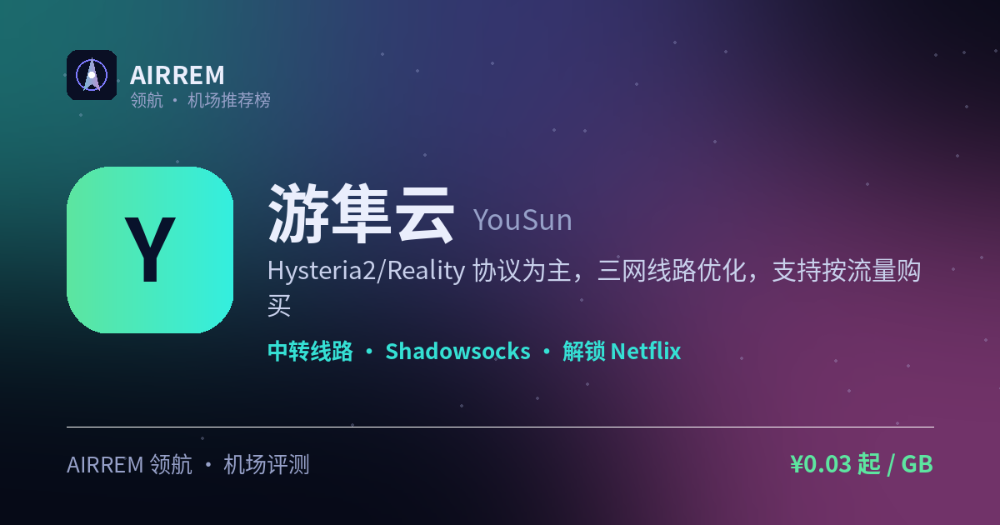

# 游隼云机场怎么样？2026 实测：大流量月付

> **游隼云** 适合谁？想要月付大流量、也可一次性买断防失联。档位最全的大流量中转：月付 ¥9 到 ¥100（480G→6000G）任选，Hysteria2 新协议抗封、三网优化

👉 **[游隼云 官网注册入口](https://s.rtxk.us/s/2fhtsh7)** ｜ [完整评测与横向对比](https://555736.xyz/yousun/)

---

## 我们的结论

主打大流量与多地区原生 IP，协议较新、抗封是卖点；套餐从 ¥9/480G 到 ¥100/6000G 月付档位齐全，另有 ¥15 起的不限时买断包（防失联用）；节点数与真实速度建议自行小额测试。

## 基本信息

| 项目 | 内容 |
| --- | --- |
| 机场名称 | 游隼云 |
| 成立时间 |  |
| 线路类型 | 三网优化中转 |
| 支持协议 | Shadowsocks / Trojan / Hysteria2 |
| 流媒体解锁 | Netflix / Disney+ / ChatGPT |
| 节点地区 | 美国 · 日本 · 香港 · 台湾 · 新加坡 等 |
| 计费方式 | 包月 / 不限时买断 |
| 起步价格 | ¥9 / 月 480G |
| 推荐场景 | 想要月付大流量、也可一次性买断防失联 |

## 游隼云 套餐价格

| 套餐 | 价格 | 说明 |
| --- | --- | --- |
| 普通 抽奖套餐 | ¥9 | 月付 · 每月 480G · 年付立减 78 元 |
| VIP 1 | ¥15 | 月付 · 每月 600G · 年付立减 150 元 |
| 普通基本套餐 | ¥20 | 月付 · 每月 1000G |
| VIP 2 | ¥25 | 月付 · 每月 1000G · 年付立减 220 元 |
| VIP 3 | ¥30 | 月付 · 每月 1500G · 年付立减 260 元 |
| VIP 4 | ¥45 | 月付 · 每月 2500G |
| VIP 5 | ¥60 | 月付 · 每月 3000G |
| VIP 6 | ¥75 | 月付 · 每月 4000G |
| VIP 7 | ¥100 | 月付 · 每月 6000G |
| 普通不限时 | ¥15 起 | 一次性买断 · 200G/500G/1000G（¥15 / ¥40 / ¥70） |
| VIP 不限时 | ¥50 起 | 一次性买断 · 600G/1000G（¥50 / ¥90） |

> 价格取自官网购买页：月付按月重置流量（VIP 档另享年付立减），不限时为一次性买断流量包；以官网实时价格为准。

## 游隼云是什么

游隼云以「大流量、多协议」为卖点，主打 Hysteria2 等较新协议，强调复杂网络下的抗封能力，并提供按流量购买的灵活计费。

## 线路 · 协议 · 解锁

据评测采用电信 CN2、联通 AS9929、移动 CMI 三网优化，覆盖美日港台新等地区并宣称原生 IP；协议以 Hysteria2 为主，解锁 Netflix、Disney+、ChatGPT。

- 三网线路优化
- 多地区原生 IP 接入
- 协议：Hysteria2 / Trojan / SS

## 优点与缺点

**✅ 优点**

- 较新协议，抗封体验较好
- 三网优化、覆盖热门地区
- 按流量购买灵活
- 可解锁主流流媒体与 AI

**⚠️ 缺点**

- 公开评测较少，运营背景信息有限
- 机场行业存在跑路风险，建议先用月付或小额套餐验证稳定性，别一上来就大额年付。

## 适合谁 / 不适合谁

| 👍 适合 | 👎 不适合 |
| --- | --- |
| 按流量计费的中轻度用户 | 需要长期稳定专线、偏好老牌大机场的用户 |
| 想尝试新协议的用户 |  |

## 常见问题

**Q：支持哪些协议？**

A：以 Hysteria2 为主，具体以官网订阅节点为准。

**Q：可靠吗？**

A：公开评测有限，建议先小额按量验证稳定性与售后。

## 同类机场推荐

拿不定主意？可以再看看这几家同类型的：

- **[守候](https://555736.xyz/shouhou/)** — 稳健老用户 / Emby 影音，¥15 起
- **[自由猫](https://555736.xyz/freecat/)** — 日常主力，¥6 起
- **[淘气兔](https://555736.xyz/taoqitu/)** — 联通移动用户，¥7.8 起

全部 38 家机场的横向对比与选购方法论：**[信号塔 SignalTower · 机场大全](https://555736.xyz/airports/)**

---

数据更新：2026-07 ｜ 价格、套餐与优惠码以官网实时为准 ｜ 本仓库为第三方评测整理，与 游隼云 官方无隶属关系 ｜ 请遵守当地法律法规使用网络服务。

关键词：游隼云、Hysteria2机场、按流量机场、三网优化、机场推荐
